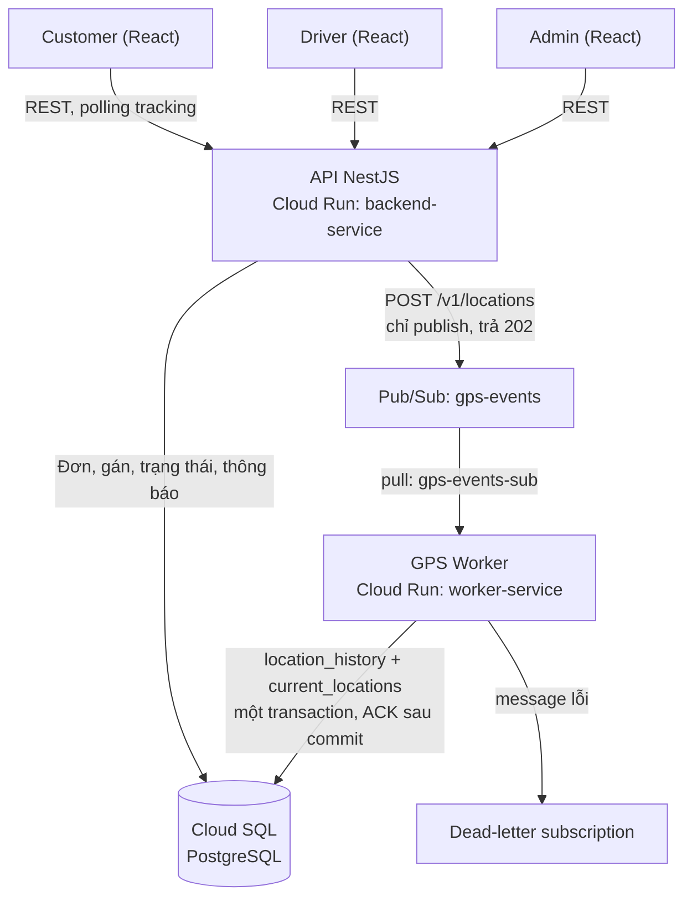

# Kiến trúc ParcelFlow

Tài liệu này mô tả cấu trúc code đang có trên `develop` và quy ước khi thêm code mới. Trạng thái từng tính năng xem ở [docs/features.md](docs/features.md).

## Tổng thể



- **Đường ghi GPS tách khỏi DB:** API chỉ publish lên Pub/Sub và trả 202 sau khi broker xác nhận, không chờ ghi DB.
- **Worker** ghi lịch sử và vị trí hiện tại trong cùng một transaction. Mẫu đầu tiên thắng theo (`"driverId"`, `"clientTimestamp"`); `current_locations` chỉ tiến, không lùi về mẫu cũ hơn.
- **Đọc vị trí:** client polling API, API đọc `current_locations`.
- Auth bằng Firebase; API nối Firebase UID với bảng `users` để lấy role và quyền.

## Monorepo

```
apps/
  api/          NestJS API, Dockerfile và lockfile riêng
  worker/       GPS Worker, Dockerfile và lockfile riêng
  web/          React + Vite, deploy Firebase Hosting
packages/
  types/        kiểu dùng chung: hợp đồng GPS, hàm ETA
  database/     SQL tạo bảng (sql/001, sql/002)
infra/
  pubsub/       script tạo topic/subscription, smoke test, DLQ replay
  firebase/     cấu hình Firebase
docs/           tài liệu, xem docs/README.md
```

## API (`apps/api/src`)

```
main.ts, app.module.ts
config/             cấu hình app, CORS, kiểm tra biến môi trường
common/             ApiExceptionFilter, ProblemDetails, log lỗi dependency
health/             GET /healthz
tools/set-role.ts   script gán role claim Firebase
modules/
  auth/             Firebase token, guard xác thực và phân quyền, decorator @Roles/@Public
  users/            nối Firebase UID với bảng users, BusinessUserGuard
  shipments/        tạo đơn, danh sách, chi tiết, lấy hàng, giao hàng
  assignments/      gán và gán lại tài xế (khóa dòng)
  location/         POST /v1/locations (publish), đọc current_locations
  notifications/    GET /v1/notifications
  admin/            danh sách tài xế và khách hàng cho Admin
  geocoding/        proxy VIETMAP cho form địa chỉ
```

Mỗi module theo một khuôn:

| Lớp | Làm gì | Không làm gì |
| --- | --- | --- |
| Controller | Route, đọc tham số, mã trạng thái | Không chứa nghiệp vụ, không truy vấn DB |
| Service | Nghiệp vụ, điều phối repository, publish sự kiện | Không đụng request/response HTTP |
| Repository | SQL qua `pg`, transaction | Không chứa luật nghiệp vụ |
| `dto/` | Parse và kiểm tra request, định dạng response | Không mang chi tiết DB |

SQL viết tay qua `pg` (không dùng Prisma lúc chạy). Tên cột camelCase có ngoặc kép, ví dụ `"driverId"`. Lỗi trả dạng ProblemDetails: 401 chưa xác thực, 403 sai quyền, 409 sai trạng thái hoặc user chưa liên kết, 503 dependency lỗi.

## Worker (`apps/worker/src`)

```
main.ts, worker.module.ts
health/                         GET /healthz
consumer/gps.subscriber.ts      nhận message, ACK sau khi ghi xong, NACK khi lỗi tạm thời
consumer/gps-processor.service.ts  kiểm tra payload theo EVT01, chuẩn hóa thời gian
consumer/dlq-replay.service.ts  phát lại message từ DLQ
storage/gps-writer.repository.ts   ghi PostgreSQL khi có DATABASE_URL, không có thì ghi bộ nhớ
```

## Web (`apps/web/src`)

```
api/            client gắn Firebase token, endpoints/ theo tài nguyên
features/       auth, customer, driver, admin: trang và logic theo vai trò
layouts/        khung trang cho từng vai trò
components/     ui/, map/ (Leaflet), shipment/ (tracking, trạng thái)
hooks/          polling tracking, vị trí tài xế
types/, utils/
```

Một app cho cả ba vai trò; route `/customer`, `/driver`, `/admin`. Polling chỉ một request chạy tại một thời điểm và dừng khi rời trang.

## Quy ước khi thêm code

- Endpoint mới: thêm vào module đúng nghiệp vụ, cập nhật `docs/openapi.json` và [API contract](docs/contracts/api-contract.md).
- Bảng hoặc cột mới: thêm file SQL đánh số tiếp trong `packages/database/sql/`, không sửa file đã chạy trên Cloud.
- Sự kiện GPS: theo [hợp đồng GPS](docs/contracts/gps-event-contract.md) và kiểu trong `packages/types`.
- Test chạm DB chạy trên PostgreSQL thật hoặc PGlite, đặt tên `*.postgres.spec.ts`.
