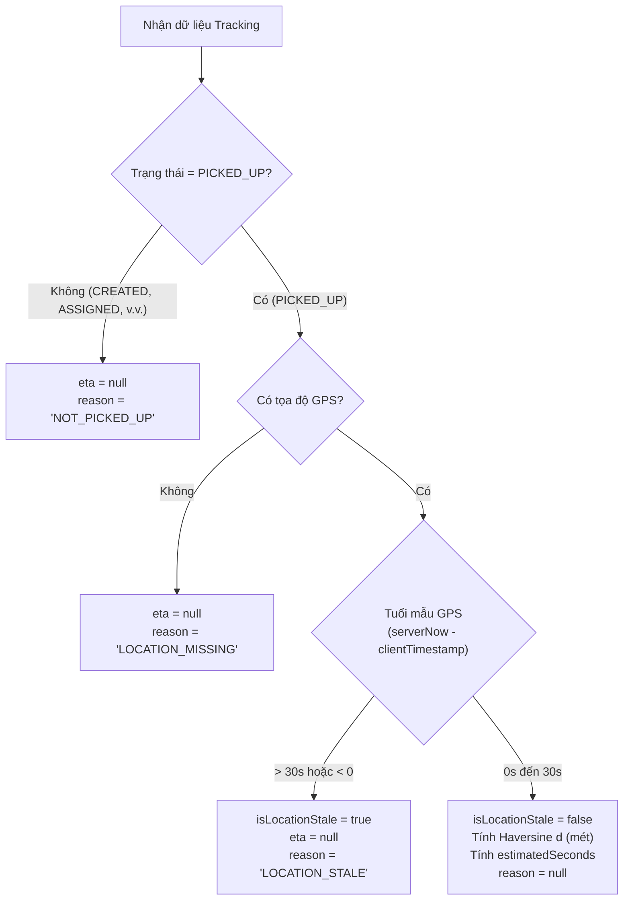

# Bàn giao TV2 — Chuẩn bị truy vấn vị trí hiện tại cho ETA tuần 10

- **Người thực hiện:** TV2 (Worker & Pipeline GPS)
- **Đối tượng bàn giao:** TV1 (API09 Tracking), TV3 (Frontend Tracking UI), TV6 (QA / Kiểm thử)
- **Thời điểm:** Tuần 9 (Chuẩn bị bàn giao cho Tuần 10)
- **Nguồn yêu cầu:** PF SPEC 01 v1.4, AC04, AC09, ETA01, SC05, DATA04.

---

## 1. Mục đích và phạm vi bàn giao

Tài liệu này chuẩn hóa và bàn giao kỹ thuật từ TV2 (Worker) cho TV1, TV3 và TV6 về:
1. **Truy vấn vị trí hiện tại của tài xế (`current_locations`)** do Worker duy trì từ luồng Pub/Sub GPS.
2. **Cơ chế đảm bảo bất biến (Invariants):** Chống lùi mốc thời gian, chống ghi đè mẫu cũ, xử lý out-of-order, và snapshot an toàn chống race condition khi reassign tài xế.
3. **Phân loại lỗi Worker ACK vs NACK (Tuần 9):** Worker ACK lỗi vĩnh viễn (như khóa ngoại `23503`) để đưa vào DLQ; chỉ NACK lỗi tạm thời (mất kết nối, timeout).
4. **Công thức và quy tắc tính ETA (AC09 / ETA01):** Haversine $20\text{ km/h}$, trần giây `Math.ceil`, và ngưỡng độ tươi 30 giây.

---

## 2. Bảng dữ liệu `current_locations` (DATA04)

### 2.1. Cấu trúc bảng (SQL Schema)

Bảng được định nghĩa trong [packages/database/sql/002-create-gps-locations.sql](file:///e:/INT3326E/packages/database/sql/002-create-gps-locations.sql):

```sql
CREATE TABLE current_locations (
  "driverId" text PRIMARY KEY REFERENCES users(id) ON DELETE CASCADE,
  lat double precision NOT NULL CHECK (lat BETWEEN -90 AND 90),
  lng double precision NOT NULL CHECK (lng BETWEEN -180 AND 180),
  "clientTimestamp" timestamptz(3) NOT NULL,
  "receivedAt" timestamptz(3) NOT NULL,
  "eventId" text NOT NULL,
  "sessionId" uuid,
  seq integer,
  "updatedAt" timestamptz(3) NOT NULL DEFAULT clock_timestamp()
);
```

### 2.2. Bất biến dữ liệu (Invariants do Worker cam kết)

1. **Khóa chính duy nhất:** Khóa chính là `"driverId"`. Mỗi tài xế chỉ có tối đa 1 bản ghi vị trí tức thời.
2. **Không lùi thời gian (Monotonicity):** Worker thực hiện conditional UPSERT:
   ```sql
   WHERE EXCLUDED."clientTimestamp" > current_locations."clientTimestamp"
   ```
   Nếu một gói tin GPS cũ hơn đến sau (do mạng chập chờn, retry, out-of-order), Worker **không bao giờ** ghi đè làm lùi vị trí hiện tại.
3. **Độ chính xác thời gian:** `"clientTimestamp"` và `"receivedAt"` được lưu với độ phân giải mili-giây (`timestamptz(3)`).
4. **Xóa theo tầng:** Khi tài xế bị xóa khỏi hệ thống, khóa ngoại `ON DELETE CASCADE` tự động dọn sạch bản ghi vị trí tương ứng.

---

## 3. Câu truy vấn SQL chuẩn cho ETA và Tracking

### 3.1. Truy vấn đơn lẻ theo `driverId` (Worker / LocationRepository)

Dùng khi cần kiểm tra hoặc lấy nhanh tọa độ hiện tại của một tài xế cụ thể:

```sql
SELECT 
  "driverId", 
  lat, 
  lng, 
  "clientTimestamp", 
  "receivedAt", 
  "eventId", 
  "sessionId", 
  seq,
  "updatedAt"
FROM current_locations 
WHERE "driverId" = $1 
LIMIT 1;
```

- **Hiệu năng:** $O(1)$ index scan trực tiếp trên Primary Key `"driverId"`.
- **Hàm có sẵn trong repo:**
  - Worker: `GpsWriterRepository.getLatestCurrentLocation(driverId)` trong [apps/worker/src/storage/gps-writer.repository.ts](file:///e:/INT3326E/apps/worker/src/storage/gps-writer.repository.ts)
  - API: `LocationRepository.getDriverCurrentLocation(driverId)` trong [apps/api/src/modules/location/location.repository.ts](file:///e:/INT3326E/apps/api/src/modules/location/location.repository.ts)

### 3.2. Truy vấn kết hợp MVCC Snapshot cho API09 (Bảo vệ khi Reassign)

Để ngăn chặn lỗi hiển thị vị trí của tài xế cũ sau khi Admin reassign đơn hàng cho tài xế mới, câu truy vấn API09 phải đọc đơn hàng và vị trí trong cùng một câu SELECT (hoặc transaction REPEATABLE READ):

```sql
SELECT 
  s.id,
  s.status,
  s."driverId",
  s."pickupLatitude" AS "pickupLat",
  s."pickupLongitude" AS "pickupLng",
  s."deliveryLatitude" AS "deliveryLat",
  s."deliveryLongitude" AS "deliveryLng",
  s."expectedDeliveryAt",
  -- Quyền truy cập
  ($2::text = 'ADMIN' 
    OR ($2 = 'CUSTOMER' AND s."senderId" = $3)
    OR ($2 = 'DRIVER' AND s."driverId" = $3)) AS allowed,
  -- Dữ liệu vị trí từ current_locations qua LEFT JOIN
  c."driverId" AS "locationDriverId",
  c.lat AS "currentLat",
  c.lng AS "currentLng",
  c."clientTimestamp" AS "locationClientTimestamp",
  c."receivedAt" AS "lastLocationUpdatedAt"
FROM shipments s
LEFT JOIN current_locations c ON c."driverId" = s."driverId"
WHERE s.id = $1;
```

**Nguyên tắc snapshot:**
- `c."driverId"` liên kết trực tiếp với `s."driverId"` hiện hành tại thời điểm đọc.
- Nếu tài xế vừa được gán chưa phát GPS nào: `c."driverId"` là `NULL`, hệ thống trả `currentDriverLocation: null` và `etaUnavailableReason: 'LOCATION_MISSING'` (hoặc `NOT_PICKED_UP`), tuyệt đối không rò rỉ tọa độ của tài xế trước đó.

---

## 4. Đặc tả tính toán ETA (AC09 / ETA01)

### 4.1. Công thức Haversine

Hàm tính khoảng cách cung tròn lớn giữa vị trí hiện tại của tài xế và điểm giao hàng (`dropoffLocation`):

$$\Delta\sigma = 2 \arcsin \sqrt{\sin^2\left(\frac{\Delta\phi}{2}\right) + \cos\phi_1 \cos\phi_2 \sin^2\left(\frac{\Delta\lambda}{2}\right)}$$
$$d = R \cdot \Delta\sigma$$

- Bán kính Trái Đất chuẩn: $R = 6,371,000\text{ mét}$ (`EARTH_RADIUS_METERS`).
- Để tránh lỗi số học `NaN` do sai số float vượt quá $1.0$, tham số $a$ được kẹp trong đoạn $[0, 1]$ bằng `Math.min(1, Math.max(0, a))`.

### 4.2. Vận tốc và Ước lượng thời gian

- Vận tốc di chuyển mặc định theo đặc tả: $v = 20\text{ km/h} = \frac{20 \times 1000}{3600}\text{ m/s} \approx 5.55556\text{ m/s}$.
- Thời gian di chuyển ước tính (giây):
  $$\text{estimatedSeconds} = \begin{cases} 0 & \text{khi } d = 0 \\ \left\lceil \frac{d}{v} \right\rceil & \text{khi } d > 0 \end{cases}$$
- Thời điểm dự kiến đến (ISO 8601 UTC):
  $$\text{estimatedArrivalAt} = \text{new Date}(\text{observedAtMs} + \text{estimatedSeconds} \times 1000)\text{.toISOString()}$$

### 4.3. Điều kiện tính và Quy tắc độ tươi (Freshness & Reason Priority)

Việc tính toán ETA phải tuân thủ thứ tự ưu tiên kiểm tra nghiêm ngặt:



1. **Trạng thái không phải `PICKED_UP`:** Không tính ETA (`eta = null`, `etaUnavailableReason = 'NOT_PICKED_UP'`). Đơn hàng ở trạng thái cuối (`DELIVERED`, `DELIVERY_FAILED`) cũng ẩn vị trí và không có ETA.
2. **Thiếu GPS:** Chưa có bản ghi trong `current_locations` $\rightarrow$ `eta = null`, `isLocationStale = null`, `etaUnavailableReason = 'LOCATION_MISSING'`.
3. **GPS bị cũ (Stale):**
   - Ngưỡng: Tuổi mẫu $\Delta t = \text{serverNowMs} - \text{clientTimestampMs} > 30,000\text{ ms}$ (30 giây) hoặc $\Delta t < 0$ (clock skew âm).
   - Kết quả: `isLocationStale = true`, `eta = null`, `etaUnavailableReason = 'LOCATION_STALE'`. Vị trí vẫn được hiển thị cho Customer kèm cảnh báo cũ.
4. **GPS tươi ($\Delta t \in [0, 30\text{s}]$):**
   - `isLocationStale = false`.
   - Trả đầy đủ object `eta: { distanceMeters, estimatedSeconds, estimatedArrivalAt }`.
   - `etaUnavailableReason = null`.
5. **Không sửa đổi `expectedDeliveryAt`:** ETA chỉ là ước tính tức thời tại thời điểm truy vấn, tuyệt đối **không** cập nhật hay ghi đè lên cột `"expectedDeliveryAt"` của bảng `shipments`.

---

## 5. Module và Tiện ích có sẵn trong Monorepo

Các thành phần dùng chung đã được cài đặt và kiểm thử 100%:

| Package / File | Thành phần | Mô tả |
| --- | --- | --- |
| `packages/types/src/eta.ts` | `calculateHaversineDistance()` | Tính khoảng cách Haversine chuẩn |
| `packages/types/src/eta.ts` | `evaluateEtaAndFreshness()` | Đánh giá độ tươi và tính ETA theo đúng thứ tự |
| `packages/types/src/eta.ts` | `buildShipmentTrackingResponse()` | Đóng gói response SC05 hoàn chỉnh |
| `apps/worker/src/storage/gps-writer.repository.ts` | `getLatestCurrentLocation()` | Đọc vị trí hiện tại trong Worker |
| `apps/api/src/modules/location/location.repository.ts` | `getDriverCurrentLocation()` | Đọc vị trí hiện tại trong API |
| `apps/api/src/modules/shipments/shipment-response.mapper.ts` | `shipmentTrackingResponse()` | Mapper trả về API09 cho controller |

---

## 6. Cập nhật Worker Tuần 9: ACK Lỗi vĩnh viễn (DLQ) vs NACK Lỗi tạm thời

Trong tuần 9, `GpsSubscriber` (`apps/worker/src/consumer/gps.subscriber.ts`) đã được nâng cấp với hàm `isPermanentDatabaseError`:

```typescript
const PERMANENT_PG_ERROR_CLASSES = new Set([
  '23503', // foreign_key_violation (ví dụ: driverId không tồn tại trong users)
  '23502', // not_null_violation
  '23514', // check_violation
  '23P01', // exclusion_violation
]);

export function isPermanentDatabaseError(error: any): boolean {
  const code: string | undefined = error?.code;
  if (!code || typeof code !== 'string') return false;
  if (PERMANENT_PG_ERROR_CLASSES.has(code)) return true;
  if (code.startsWith('42')) return true; // Lỗi cú pháp/schema class 42
  return false;
}
```

### Nguyên tắc xử lý trong Worker:
- **Lỗi vĩnh viễn (Permanent - `23503`, `23502`, class `42xxx`):** Worker log `[GPS Persistence Permanent]`, gọi `message.ack()`. Tin nhắn không bị thử lại vô tận (tight loop), mà được Pub/Sub chuyển vào Dead Letter Queue (DLQ `gps-events-dlq`) theo dead-letter policy để phân tích sau.
- **Lỗi tạm thời (Transient - Connection timeout, `ECONNREFUSED`, `57P01` admin shutdown):** Worker log `[GPS Persistence Failed]`, gọi `message.nack()`, ném ngoại lệ để transaction rollback hoàn toàn và Pub/Sub redeliver sau khoảng thời gian backoff.

---

## 7. Kế hoạch kiểm thử (Test Plan) cho TV6 trong Tuần 10

| Mã Test | Kịch bản kiểm thử | Kỳ vọng nghiệm thu |
| --- | --- | --- |
| **TC09.1** | Đơn `PICKED_UP`, vị trí GPS mới ($\Delta t \le 30\text{s}$) cách đích ~4.1 km | `eta.distanceMeters` $\approx 4100-4200\text{m}$, `estimatedSeconds` $\approx 740-760\text{s}$, `estimatedArrivalAt` hợp lệ, `etaUnavailableReason = null`, `isLocationStale = false`. |
| **TC09.2** | Vị trí tài xế trùng với tọa độ giao hàng (`pickupLocation == dropoffLocation`) | `distanceMeters = 0`, `estimatedSeconds = 0`, `estimatedArrivalAt == serverNow`, không bị NaN/Infinity. |
| **TC09.3a** | Đơn `PICKED_UP` nhưng tài xế chưa gửi GPS nào (`current_locations` rỗng) | `currentDriverLocation = null`, `eta = null`, `etaUnavailableReason = 'LOCATION_MISSING'`, `isLocationStale = null`. |
| **TC09.3b** | Đơn `PICKED_UP`, GPS cũ ($\Delta t = 31\text{s} > 30\text{s}$) | Vị trí vẫn trả về, `isLocationStale = true`, `eta = null`, `etaUnavailableReason = 'LOCATION_STALE'`. |
| **TC09.4a** | Đơn `CREATED` hoặc `ASSIGNED` có GPS | Trả về vị trí (nếu ASSIGNED), nhưng `eta = null`, `etaUnavailableReason = 'NOT_PICKED_UP'`. |
| **TC09.4b** | Đơn `DELIVERED` hoặc `DELIVERY_FAILED` (Terminal status) | `currentDriverLocation = null`, `eta = null`, `etaUnavailableReason = 'NOT_PICKED_UP'`. |
| **TC09.4c** | Toàn bộ các lần tính ETA | Cột `"expectedDeliveryAt"` trong bảng `shipments` giữ nguyên giá trị ban đầu, không bị ghi đè. |
| **TC04.8b** | Worker gặp lỗi khóa ngoại `23503` (driverId rác) | Worker log `[GPS Persistence Permanent]`, gọi `ack()`, không bị kẹt message; message được định tuyến vào DLQ. |
| **TC04.8c** | Worker gặp lỗi DB timeout/mất kết nối | Worker log `[GPS Persistence Failed]`, gọi `nack()`, message được redeliver khi DB sẵn sàng trở lại. |
